# Portofolio Web - UAS Pemrograman Web

- Nama: Mohamad Fauzi Febrianto
- NIM: 252410102006
- Prodi: Teknologi Informasi
- Fakultas: Fakultas Ilmu Komputer

## Tentang proyek

Ini website portofolio untuk tugas UAS Praktikum Pemrograman Web. Saya lanjutkan dari proyek UTS. Bedanya, sekarang datanya disimpan di database MySQL dan ada dua role, yaitu admin dan user.

Dibuat dengan Laravel dan Blade.

## Yang bisa dilakukan

- **Admin:** mengelola kategori dan proyek (tambah, edit, hapus).
- **User:** hanya bisa melihat daftar proyek.
- Login dan logout, dark mode, dan tampilan yang menyesuaikan layar HP.

## Akun untuk mencoba

| Role  | Username | Password   |
| ----- | -------- | ---------- |
| Admin | `admin`  | `admin123` |
| User  | `fauzi`  | `fauzi123` |

## Pembatasan akses

Semua halaman di dalam aplikasi dijaga middleware `auth`, jadi harus login dulu. Halaman kategori dan fitur tambah, edit, hapus proyek dijaga middleware `role:admin` (kode ada di `CheckUserRole`). Kalau user biasa membukanya, yang muncul halaman 403.

## Database

Ada tiga tabel: `users`, `kategoris`, dan `proyeks`. Satu kategori bisa punya banyak proyek, jadi tabel `proyeks` punya kolom `kategori_id` yang mengarah ke `kategoris`.

## Cara menjalankan

Siapkan PHP 8.3 ke atas, Composer, dan MySQL yang sudah menyala.

```powershell
composer install
cp .env.example .env
php artisan key:generate
php artisan migrate --seed
php artisan serve
```

Kalau ditanya apakah database `uas_pweb` mau dibuat, jawab `yes`. Kalau MySQL kamu memakai password, isi `DB_PASSWORD` di file `.env`. Setelah itu buka http://localhost:8000.

## Screenshot

**Login**

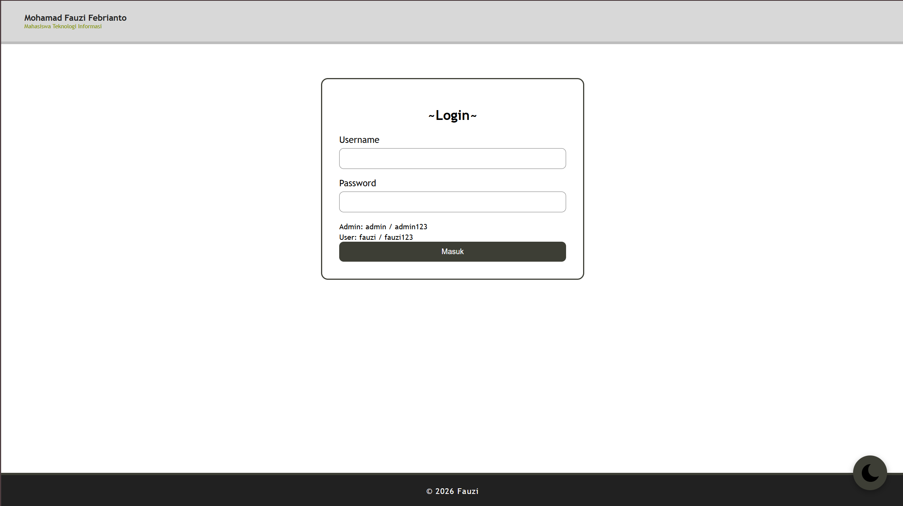

**Dashboard (admin)**

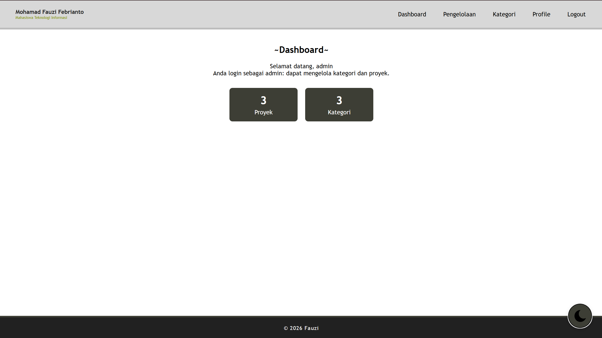

**Dashboard (user)**

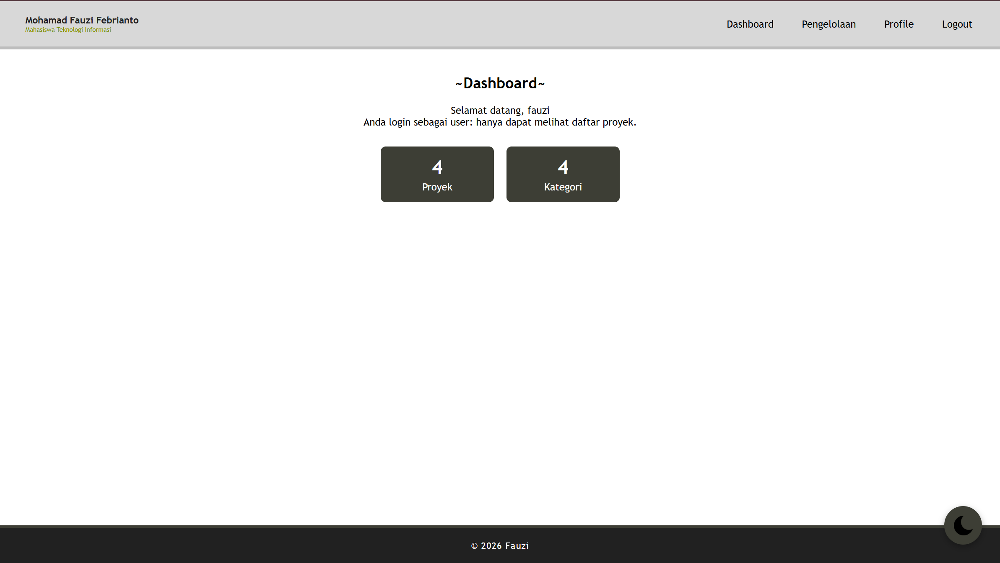

**Pengelolaan proyek (admin)**

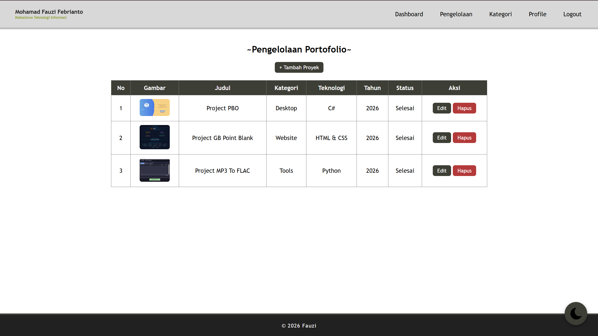

**Tambah proyek**

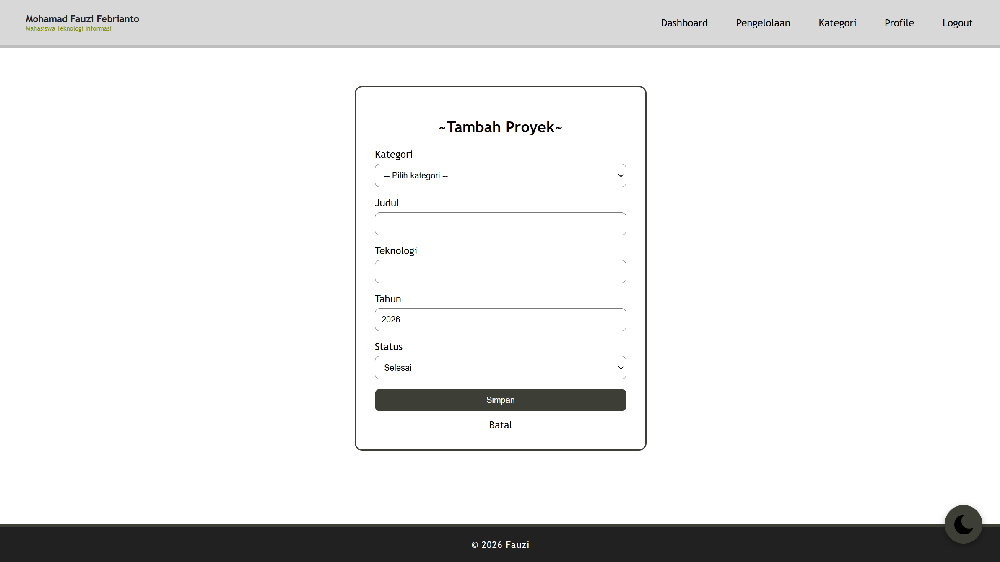

**Edit proyek**

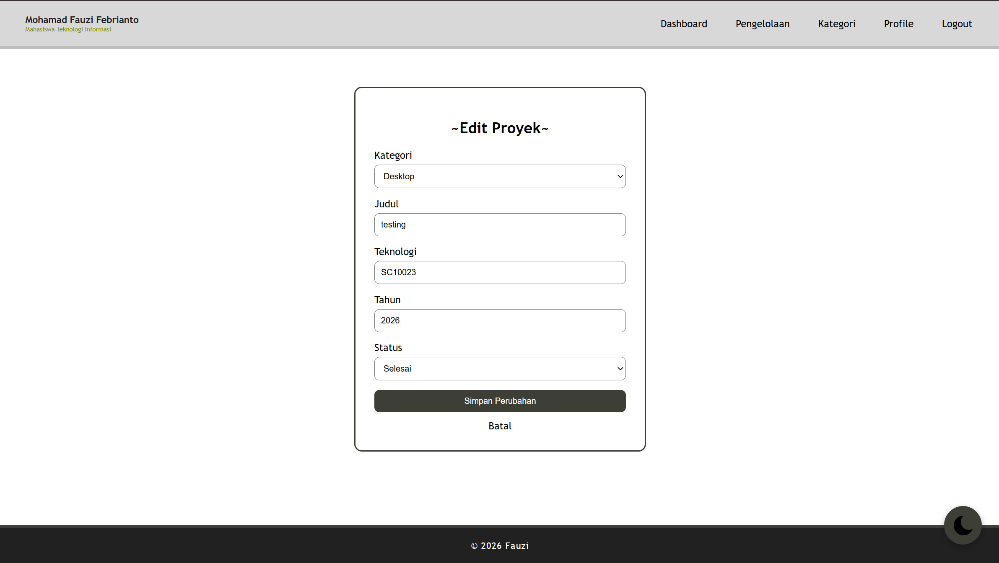

**Daftar kategori (admin)**

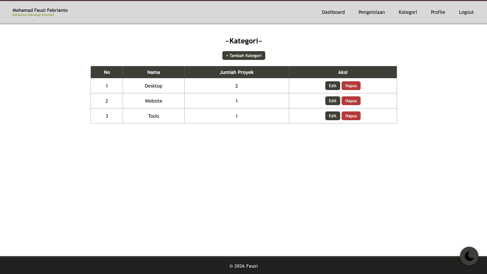

**Tambah kategori**

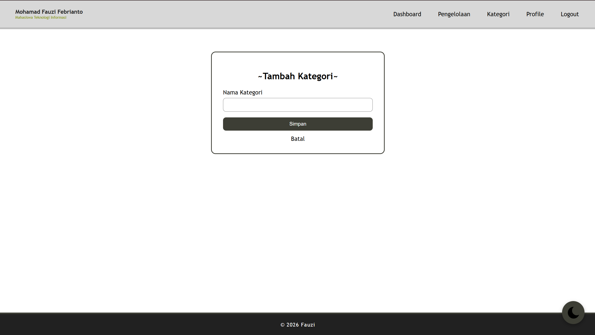

**Edit kategori**

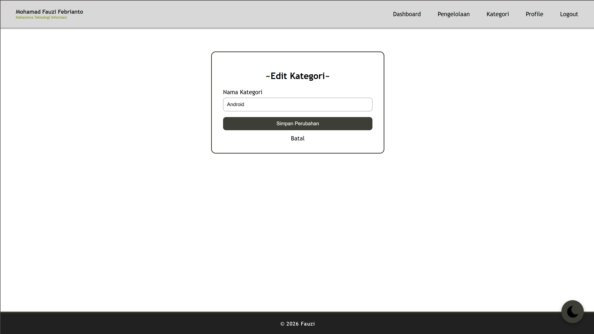

**Pengelolaan proyek (user, hanya bisa melihat)**

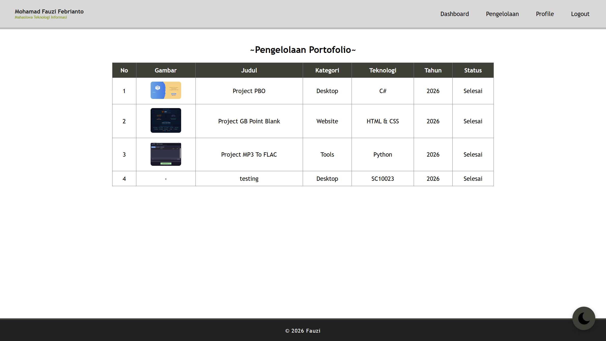

**User membuka halaman admin (403)**

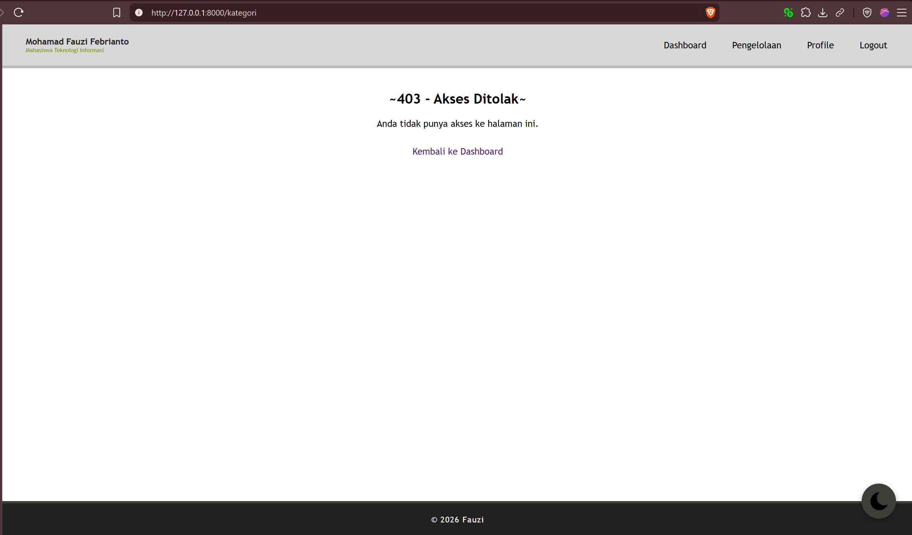

**Profile**

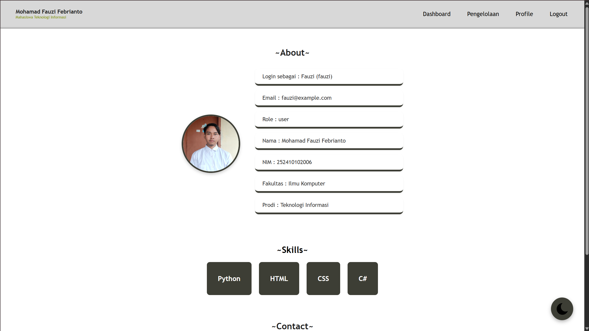
